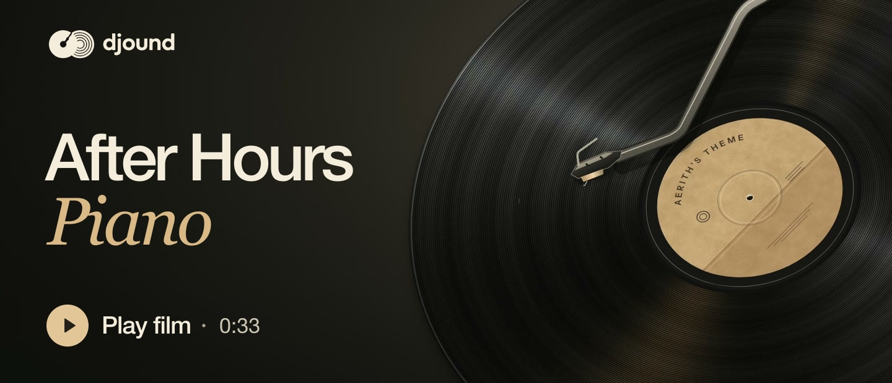

# Djound

Djound is an open-source music studio for reimagining a recording in your own words. Bring a song, choose a style or describe how you want it to sound, then listen and refine the edit you like. Your original, edit history and exported WAVs stay on your Mac. [Product vision](guide/product.md) · [API contract](contracts/openapi.yaml)

[](showcase/release/after-hours-piano.mp4)

**[Watch After Hours Piano with sound](showcase/release/after-hours-piano.mp4)** · Listen for the brushes under the held piano note. At 0:16 the same phrase returns as a drumless piano duet. [Music credits](THIRD_PARTY_NOTICES.md#featured-film)

## run it locally

for the local rendition studio, use an Apple Silicon Mac with Git, Apple Command Line Tools, CMake, Python 3.11, uv, FFmpeg, pnpm 11.5.0 and Docker with Compose. start Docker, then run these commands from the repo root.

```sh
bash scripts/bootstrap.sh
bash local-engine/renditions.sh setup
bash local-engine/renditions.sh check
bash scripts/package.sh
DJOUND_MODE=LOCAL bash scripts/run.sh
```

Open **http://127.0.0.1:8080**. Choose **Bring a recording** to start from your own file, or **Try an edit** to open the example jazz arrangement. Select an edit in Studio before asking for the next change.

Setup downloads the tools and models. Use the [running guide](guide/running.md) for model choices, the optional mix and melody engines and installation checks.

## how it works

in the rendition engine, the same local Qwen3 4B model interprets your request and directs the arrangement. older installations can use the smaller Qwen3.5 0.8B model. when the worker can follow a tune in the recording, the director chooses how fast to play it, who carries the melody and how the other players accompany it. a new take can have its own tempo and ending. its saved arrangement gives the next request something concrete to change. the player performs the score locally. ACE-Step handles generated sound treatments, passage changes and direct covers of recordings with little reliable pitch information. each ready take keeps its own audio and the request that led to it.

in the melody engine, Basic Pitch detects the notes. you can correct them, keep the uploaded performance as the lead, or play them on a different instrument. the renderer builds the backing from the arrangement you approve. the melody setup includes built-in text edits and direct controls. running `bash local-engine/setup_localengine.sh` without flags installs the melody and finished mix engines plus the optional Qwen arrangement planner.

spring boot manages the api, postgres keeps project history, and a python worker handles transcription and rendering. [architecture](guide/architecture.md) · [setup and troubleshooting](guide/running.md) · [contributing](CONTRIBUTING.md) · [license](LICENSE)
