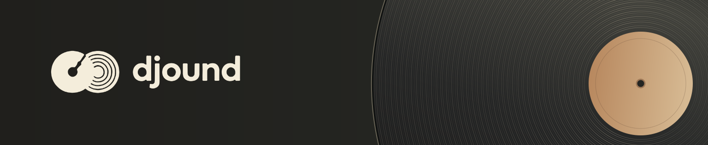

[](#after-hours-piano)

Djound is an open source music studio for editing a recording in your own words. The music and the models stay on your Mac.

## After Hours Piano

https://github.com/user-attachments/assets/4e4c4495-6e98-49cd-a9b3-9fc61b7fcebe

Listen at **0:16**. The brushes drop out and an acoustic piano carries Aerith’s melody over soft electric piano. [Download the film](showcase/release/after-hours-piano.mp4) · [Music credits](THIRD_PARTY_NOTICES.md#featured-film)

## Editing a recording

1. **Bring a recording.** Choose a song and describe what you want to hear. In the film, part of the request was “No drums. No bass.”
2. **Play the new edit.** Switch between performances to hear what changed. Choose the version you like under **Editing from** and ask for another change. The last request for *After Hours Piano* was “Cut the outro. Finish with the melody.”
3. **Keep your favorite.** Star it, reopen it from your library, or choose **Export audio** to save the WAV.

## How the engine works

For an arrangement like the piano duet, a Python worker transcribes the melody. Qwen interprets the request and directs a score with parts for each player. A local synthesizer performs it. The studio saves the score with the audio, so the next request can change the ending and keep the piano parts you liked. For edits to the recorded sound itself, the worker can use a local audio model. Spring Boot manages the jobs and PostgreSQL keeps each edit tied to its parent. [Inside the engine](guide/architecture.md)

## Run it locally

Start Docker on an Apple Silicon Mac and install the [prerequisites](guide/running.md). Run these commands from the checkout.

```sh
bash scripts/bootstrap.sh
bash local-engine/renditions.sh setup
bash local-engine/renditions.sh check
bash scripts/package.sh
DJOUND_MODE=LOCAL bash scripts/run.sh
```

Open [the studio](http://127.0.0.1:8080) and choose **Try an edit** to hear the included example. [Setup and troubleshooting](guide/running.md) · [Contributing](CONTRIBUTING.md) · [License](LICENSE)
