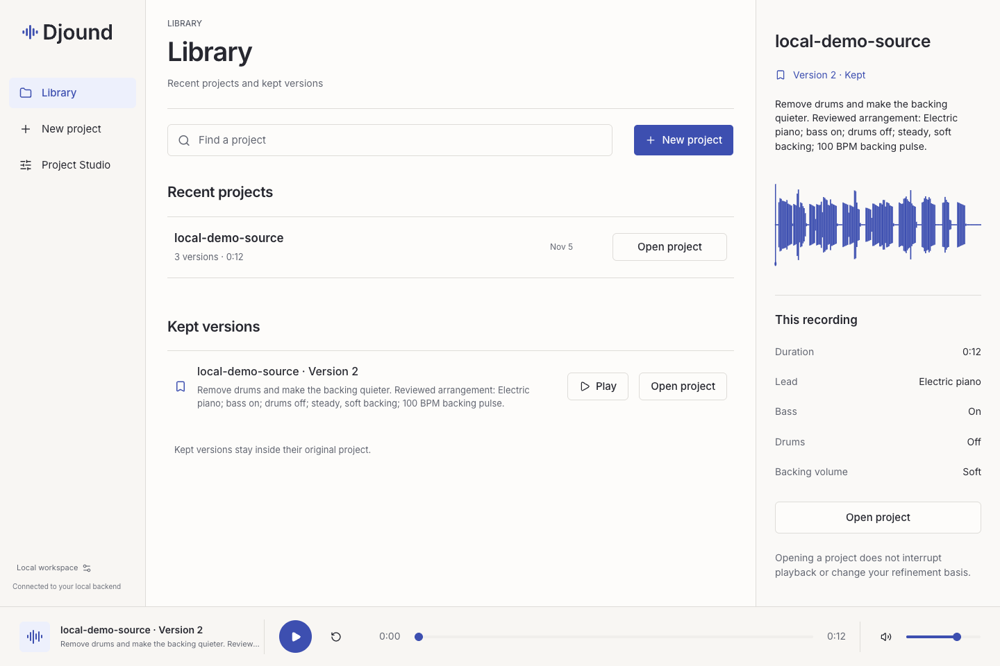

#  Djound

bring a recording you love and hear it played another way. the aim is a performance where you can hum along with the tune while the players surprise you. choose **Jazz Trio**, **Solo Piano**, **Lo-fi Hip-hop**, or **Cinematic Strings**, or type your own idea, such as “fingerpicked guitar and cello, with the tune on cello.” switch between the new take and the original, refine it, and download the one you want to share. [run it locally](#run-it-locally)

## reimagine a recording

1. choose **New project** or **Reimagine a recording** in the library and bring an MP3, WAV, or M4A. a song, a friend's performance, or a hummed voice memo can be the starting point. the importer accepts mono or stereo recordings from one second to five minutes, up to 64 MiB.
2. choose a style to hear an instrumental take. try **Solo Piano** on a sung demo and listen for the phrase you used to sing. the model can change the phrasing, lose some of the tune, or leave traces of the voice. try another take if the first one misses what you love about the recording.
3. play the take you want to change and describe the next move. try “keep the piano, but make the ending quieter.” choose a passage if you want exact boundaries. you can switch back to the original at the same playback time or pick an earlier take and start another version from it.
4. choose **Keep as favorite** to reopen the project on that take. every completed version stays in the project. **Download this take** saves the selected stereo WAV to send to a friend.

on a 16 GB M2 Pro, **Jazz Trio** took 84 seconds for a 2:49 piano performance of *To Zanarkand* rendered from MIDI. asking “make just the last 8 seconds gentler” took 23 seconds and preserved every sample before the edit. these are timings from one local session.

## edit a finished mix

choose **edit a finished mix** in the studio and drop a stereo mp3. the editor accepts recordings up to five minutes at 44.1 or 48 kHz. select up to 30 seconds, loop the passage and type “bring the vocal forward here.” switch A/B at the same song position to hear the difference. after hearing a preview, try “a little less.” you can also adjust the drums or reuse the drum setting from an earlier take.

the separator estimates vocals and drums from the stereo recording. cymbals, guitars and reverb can leak into the estimates. if a boost would clip, choose a smaller change or approve a trim for that passage. **keep** saves the take you heard. you can return to its parent with **undo**, reopen a project and export the kept stereo WAV.

## arrange a melody

https://github.com/user-attachments/assets/1cfd24dc-9335-4bde-b36a-2e2d5e50495b

in this demo of the melody editor, i start with a piano phrase from *to zanarkand*, check the notes, and try it on electric piano with bass and drums. then i take the drums out and soften the bass. you can hear the original at 0:15 and the final take at 0:27. the film uses audio from the app and shortens the processing waits. [watch or download the film](showcase/release/zanarkand.mp4) · [music credits](THIRD_PARTY_NOTICES.md#featured-film)


start from the original or pick a version you like. try “make this soundtrack jazz like” or choose **try swing combo**. review the chords and tempo, then create a version with piano, walking bass and swing ride behind your recording. select that version and type “quieter drums” to lower just the drums by 3 dB.

you can also change a single chord, set a track’s gain or pan, and preview a warmer or brighter tone in the full mix. keep the takes you like in your library.

<details>
<summary>see the library</summary>



</details>

## run it locally

for the local rendition studio, use an Apple Silicon Mac with Git, Apple Command Line Tools, CMake, Python 3.11, uv, FFmpeg, pnpm 11.5.0 and Docker with Compose. start Docker, then run these commands from the repo root.

```sh
bash scripts/bootstrap.sh
bash local-engine/renditions.sh setup
bash local-engine/renditions.sh check
bash scripts/package.sh
DJOUND_MODE=LOCAL bash scripts/run.sh
```

setup downloads the tools and models. the native Metal backend runs the quantized ACE-Step 1.5 Turbo audio model locally. the four style buttons supply a musical direction directly. Qwen interprets custom requests in the context of the take you chose. the running guide also covers configuring the ACE-Step HTTP service on a larger host. [open Reimagine](http://127.0.0.1:8080/renditions?mode=backend) · [rendition setup and backend choices](guide/running.md#generate-song-renditions)

for the finished mix editor, use `bash local-engine/setup_localengine.sh --finished-mix` and open **Mix editor**. it uses its own vocal and drum separation model.

for the melody workflow, run `bash local-engine/setup_localengine.sh --audio-only`. upload an isolated phrase as a 1 to 12 second pcm16 wav or mp3 at 44.1 or 48 khz. choose **detect melody**, listen, then select **use this melody**. [sample melody](fixtures/audio/local-demo-source.wav)

## how it works

in the rendition studio, ACE-Step receives the selected recording and an instrumental direction. each ready take has its own audio file, the original request, and a link to the version it grew from.

in the melody editor, Basic Pitch detects the notes. you can correct them, keep the uploaded performance as the lead, or play them on a different instrument. the renderer builds the backing from the arrangement you approve. the melody setup includes built-in text edits and direct controls. running `bash local-engine/setup_localengine.sh` without flags installs the melody and finished mix engines plus the optional Qwen arrangement planner.

react and typescript run the studio. spring boot manages the api, postgres keeps project history, and a python worker handles transcription and rendering. [architecture](guide/architecture.md) · [setup and troubleshooting](guide/running.md) · [contributing](CONTRIBUTING.md) · [license](LICENSE)
