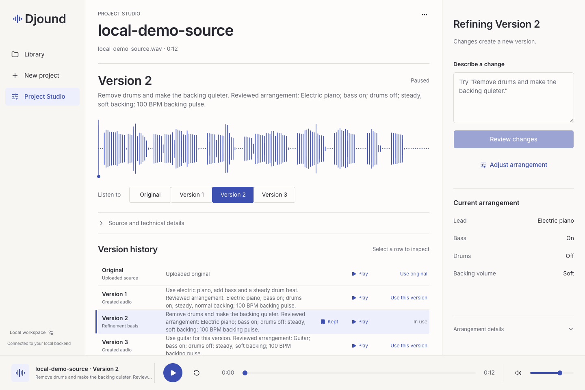

#  Djound

a local music studio for trying different arrangements of a melody. bring a short recording, describe an edit, and hear it alongside the take you started with.

https://github.com/user-attachments/assets/1cfd24dc-9335-4bde-b36a-2e2d5e50495b

in the demo, i start with a piano phrase from *to zanarkand*, check the notes, and try it on electric piano with bass and drums. then i take the drums out and soften the bass. you can hear the original at 0:15 and the final take at 0:27. the film uses audio from the app and shortens the processing waits. [watch or download the film](showcase/release/zanarkand.mp4) · [music credits](THIRD_PARTY_NOTICES.md#featured-film)

## in the studio



start from the original or pick a version you like. try “make this soundtrack jazz like” or choose **try swing combo**. review the chords and tempo, then create a version with piano, walking bass and swing ride behind your recording. select that version and type “quieter drums” to lower just the drums by 3 dB.

you can also change a single chord, set a track’s gain or pan, and preview a warmer or brighter tone in the full mix. keep the takes you like in your library.

<details>
<summary>see the library</summary>


</details>

## run it locally

use an apple silicon mac with python 3.11, uv, apple command line tools, ffmpeg, pnpm 11.5.0 and docker with compose. start docker, then run these commands from the repo root.

```sh
bash scripts/bootstrap.sh
bash local-engine/setup_localengine.sh --audio-only
bash scripts/package.sh
DJOUND_MODE=LOCAL bash scripts/run.sh
```

open [the studio](http://127.0.0.1:8080/?mode=backend) and upload [the sample melody](fixtures/audio/local-demo-source.wav) or your own isolated phrase. use a 1 to 12 second pcm16 wav or mp3 at 44.1 or 48 khz. choose **detect melody**, listen, then select **use this melody**. the first setup downloads the tools and audio assets. after that, editing runs on your mac.

## how it works

basic pitch detects the notes. you can correct them, keep the uploaded performance as the lead, or play them on a different instrument. the local renderer builds the backing from the arrangement you approve. each version saves its notes, settings and audio, so you can come back to the same take.

the setup above includes the built in text edits and direct controls. for broader phrasing, run `bash local-engine/setup_localengine.sh` to add the optional qwen planner. it can miss unfamiliar wording. specific requests such as “quieter drums” and the named arrangement choices are the most dependable way to use the editor.

react and typescript run the studio. spring boot manages the api, postgres keeps project history, and a python worker handles transcription and rendering. [architecture](guide/architecture.md) · [setup and troubleshooting](guide/running.md) · [contributing](CONTRIBUTING.md) · [license](LICENSE)
