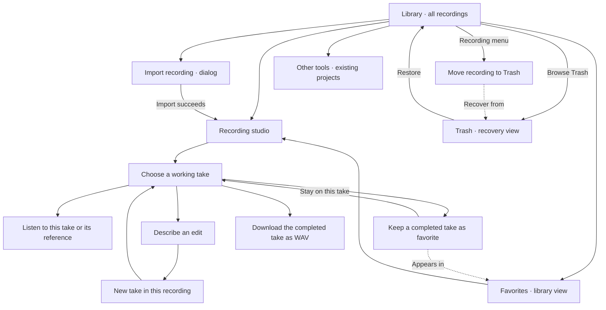

# Djound app map

A recording is the project. A take is a performance of that recording. A request belongs to the take it starts from and leads to a new take, a question or an error. The library helps a listener find their music. Opening a recording gives them one studio in which to listen and make decisions.

## Navigation

| Surface | Address or entry | What belongs here |
| --- | --- | --- |
| Library | `/` with `/renditions` as an existing entry | A title search, Import and a collection of recordings. Show the favorite take and any work in progress on the recording row. On the first visit, make bringing a file the obvious action. A one-recording library shows that one real recording. |
| Favorites | `/?view=favorites` | A linkable view of the same library. Each row opens the specific kept take. Keep the title, search and row layout familiar. |
| Recording studio | `/renditions/:id` | Original playback, a direction in the listener’s words, and takes for this recording. A plain link opens its favorite if one exists, otherwise Original. |
| Selected take | `/renditions/:id?take=:takeId` | The same studio, opened on a specific performance. Show the take name, parent, its request, and its listening, editing and export actions. `?take=original` always opens the source, even after a favorite has been kept. Original offers playback and a first edit. |
| Trash | `/?view=trash` | A recoverable collection available from Library. Restore a recording and return to its saved takes. An old studio link to a trashed recording offers Restore in place. |
| Other tools | Secondary navigation | Preserve access to existing mix and melody projects through their current editor URLs and a secondary project list. Give listeners a direct path back to the recording library. |

The library stores its search in the URL and the focused recording and scroll position on its history entry. Browser Back and the studio’s collection link return to that view. A direct link from another app gets a plain Library link. The secondary project list lives at `/tools/library`. [Release walkthrough](../design-qa.md)

## Listener journeys

| Starting point | Route through the app | What needs designing |
| --- | --- | --- |
| A file on my laptop | Library → Import → Original → first take | One file picker or drop target with the accepted formats and limits. If validation fails, explain how to fix the file in the dialog. After import, show Play and a few editable style suggestions. A listener can also type their own direction immediately. |
| A take I like, with one change in mind | Recording → choose take → edit → listen to the result | Put the working take’s name on the composer. Keep the request and its resulting performance together in history. During a render, show the actual job state there and keep its parent playable. Put a clarification and its answer in the same place. |
| Two versions of the same phrase | Take → hear parent or Original → return to take | Use one transport. A comparison toggle changes which audio is heard at the corresponding song position. Choosing a take from history explicitly changes which performance will receive the next instruction. It also changes the take named by Favorite and Export. |
| An ending that needs a change | Take → choose passage → preview → edit | A passage control beside the waveform sets start and end against the working take’s clock. Display the bounds beside the submitted words. Clear the scope when returning to a whole-take request. On a phone, close the passage controls back to the same composer. |
| A version I want to keep or send | Take → Keep as favorite → Favorites → reopen, or Take → Export WAV | Show the favorite immediately on the take and library row. Keeping another take replaces that recording’s favorite. Export downloads the selected audio and leaves the studio open. Use a readable recording and take name in the suggested filename. |
| I left and came back | Library → recording with work in progress, or saved take link → Studio | Read the request and current state from the server. An ambiguous submission can resume using its original request key. If the take in a link is missing, name the available fallback before an edit can be sent. |
| A recording disappeared | Library → Trash → Restore, or saved studio link → Restore | Restore the stable recording ID, favorite and history. A recording with a running job can explain why moving it to Trash must wait. Distinguish a missing recording from an unavailable server. |

## Where the agent belongs

Use one take history. Each entry can show the listener’s actual words, what they were editing, the request’s state and a playable result. Expand a long instruction or technical explanation on demand. A queued request, an answer to a question and a failed take all have a place in this history. The listener can keep playing while deciding what to do next.

If a question arrives while the listener is elsewhere, reopening it restores its own parent and passage. Answering it targets that request. Recovering an interrupted submission reuses its request key. Revising a failed musical direction starts a fresh request with the earlier words available to edit.

Comparison is temporary listening state. Toggling it keeps the working-take URL, the draft and the passage selection. Selecting a take updates the current studio URL in place, so Back still returns to the previous page. When a job finishes, offer the new result in its history entry. The listener decides when to play it or make the next edit from it. Reloading a take link reopens it paused.

Import, passage selection, clarification, keeping a favorite and exporting have short-lived controls on these screens. All use the recording or take already in context. On a phone, place playback and the named composer in reading order, with history in an expandable panel. Dismissing the panel returns focus to its opener. Library filters and deep links behave the same at every width.

## What the reference flows changed

| Web flow on Mobbin | Observed sequence | Decision for Djound |
| --- | --- | --- |
| [Stripe transaction detail](https://mobbin.com/flows/6c089c59-5458-4da2-943e-3b80a8f13a6c?tab=screens&utm_source=chatgpt&utm_medium=ai-assistant&utm_source_platform=mcp) and [Vercel project overview](https://mobbin.com/flows/5a5c97f3-f719-49c1-b42b-3c1dc9c9dd53?tab=screens&utm_source=chatgpt&utm_medium=ai-assistant&utm_source_platform=mcp) | Stripe opens an item with a collection link above its title and a history below. Vercel’s searchable project selector puts the selected project in the same header position. | Keep Library reachable above the recording name, which stays anchored as takes change. A saved take link opens directly into that hierarchy. |
| [SoundCloud uploading a track](https://mobbin.com/flows/496c055a-88ea-41dd-8588-4c3c061b01e4?tab=screens&utm_source=chatgpt&utm_medium=ai-assistant&utm_source_platform=mcp) and [Suno remixing a hook](https://mobbin.com/flows/03d91fa0-8d52-40c1-8bf7-25f968be41c9?tab=screens&utm_source=chatgpt&utm_medium=ai-assistant&utm_source_platform=mcp) | SoundCloud offers a single upload target. Suno carries source audio into the workspace and shows playable results beside its direction controls. | Import directly into Original. Once the recording is available, put the first direction and first listen in the same studio. |
| [Replit editing an output](https://mobbin.com/flows/d3355324-0ea5-45af-aeda-ffe4d42a3692?tab=screens&utm_source=chatgpt&utm_medium=ai-assistant&utm_source_platform=mcp) and [Lovable editing a selection](https://mobbin.com/flows/4b8d19a0-245d-4579-884b-f3b2275b0d00?tab=screens&utm_source=chatgpt&utm_medium=ai-assistant&utm_source_platform=mcp) | Replit shows the written follow-up, progress and resulting checkpoint beside a preview. Lovable lets a user target one visible element before entering the change. | Place the request beside its playable result. Put whole-take or passage scope on the composer and retain it through clarification. |
| [Lovable restoring a version](https://mobbin.com/flows/a817e8b7-5e88-40ca-aed5-fc34f4c346be?tab=screens&utm_source=chatgpt&utm_medium=ai-assistant&utm_source_platform=mcp) | A named version can be inspected beside its preview. Restoring it is a distinct action. | Give audition and explicit selection different controls. An edit to an older take creates a new child. Its later takes remain available. |
| [Spotify adding to Library](https://mobbin.com/flows/b19119a3-0a48-4a11-a486-3eda5b90a755?tab=screens&utm_source=chatgpt&utm_medium=ai-assistant&utm_source_platform=mcp) and [Riverside exporting a file](https://mobbin.com/flows/1731a505-94f2-485c-959a-95f4333a18c8?tab=screens&utm_source=chatgpt&utm_medium=ai-assistant&utm_source_platform=mcp) | Spotify marks the item in place and adds it to the library. Riverside makes export available from the editor and offers a way to continue editing. | Favorite in place, show the kept take on its library row, and serve the existing WAV directly from the studio. |
| [Linear archived items](https://mobbin.com/flows/4418e432-5264-4afa-acc5-64beebc7c2f5?tab=screens&utm_source=chatgpt&utm_medium=ai-assistant&utm_source_platform=mcp) | The archive is a destination with populated and empty states. | Give Trash its own library view and a direct Restore action. |

## Component detail for the next mockups

Use the collection link, title, grouped actions and aligned rows from Stripe’s detail view. For a dark direction, separate graphite surfaces using small changes in value and reserve the strongest accent for an action or active state. Keep a one-recording library truthful. [Stripe detail](https://mobbin.com/screens/c3813cc0-16e8-45ef-8633-f21fe4f16652?utm_source=chatgpt&utm_medium=ai-assistant&utm_source_platform=mcp) · [Supabase Projects](https://mobbin.com/screens/f36deffe-a1ad-4d9b-b6a3-4917666dc67c?utm_source=chatgpt&utm_medium=ai-assistant&utm_source_platform=mcp)

Give the take, its request and the next edit a common visual boundary. Use small, aligned times and explicit selection marks. Let history collapse when the song needs the space. The real waveform gives the listener a useful point to return to when comparing. [Cursor agent review](https://mobbin.com/screens/d744068a-1835-4c35-afa2-e560ccbe565d?utm_source=chatgpt&utm_medium=ai-assistant&utm_source_platform=mcp) · [v0 version selector](https://mobbin.com/screens/23208a65-736c-4d96-9555-51870808e1ff?utm_source=chatgpt&utm_medium=ai-assistant&utm_source_platform=mcp) · [SoundCloud audio comparison](https://mobbin.com/screens/43324600-d20f-495a-9867-b03543e7d75c?utm_source=chatgpt&utm_medium=ai-assistant&utm_source_platform=mcp)
