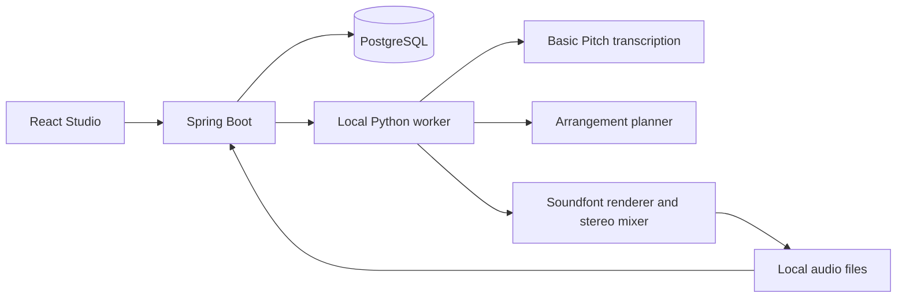

# Architecture

Djound serves the Studio and API from one local Spring Boot process. PostgreSQL stores the project, draft, confirmed notes, approved arrangements and version history. Audio lives on disk. The [OpenAPI contract](../contracts/openapi.yaml) supplies the TypeScript client types.

## From recording to version

1. Spring validates and saves the upload. Basic Pitch proposes notes. The listener compares them with the original and confirms or corrects them.
2. The planner starts from the chosen version. Built in text edits, named arrangements and the optional Qwen planner produce a recipe for review. Direct controls edit that same recipe. A swing combo can use the confirmed notes to suggest chords and a pulse.
3. Creating a version freezes its source, note revision and recipe. The worker decodes the uploaded performance or plays the lead on the selected instrument. It renders separate backing tracks, applies the approved gain, pan and tone, and checks the stereo output.
4. Spring publishes the recording after validation. A new version can inherit its settings. Earlier versions retain their audio, including when the listener later revises the melody.

## Playback and recovery

One browser player handles the original, auditions and saved takes. A tone audition remixes the verified dry tracks of a saved version and returns a temporary WAV. Only an explicit creation adds a version to the library.

The database tracks jobs and request receipts. Replaying an accepted request returns its existing result. Draft and note revisions protect against stale edits. An interrupted local job can be retried deliberately after restart. A single worker, deadlines and memory checks bound inference on the supported Mac.

[Worker assets and checksums](../local-engine/assets.json) · [Local setup and storage](running.md)
