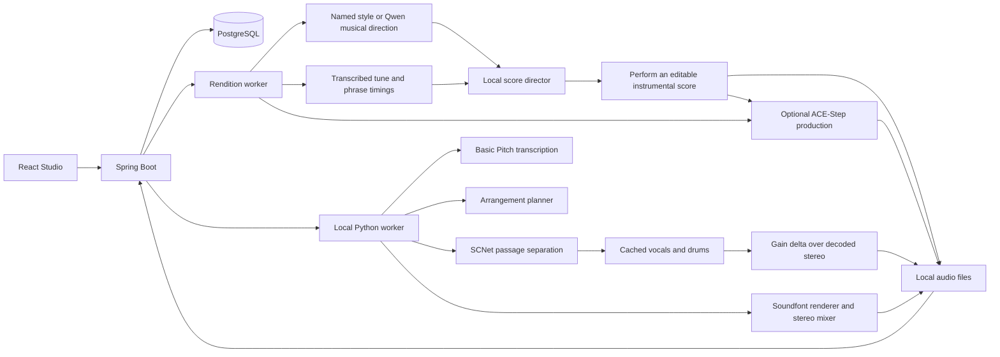

# Architecture

Djound serves the React studio and its API from a local Spring Boot process. PostgreSQL records projects, take history and preferences. Audio lives on disk. Three workflows share this installation. Reimagine performs a new version of a recording, Mix editor adjusts estimated instruments in a stereo passage, and the melody editor builds an arrangement from confirmed notes. [Rendition API client](../web/src/renditions/api.ts) · [Finished mix client](../web/src/mixes/api.ts) · [OpenAPI contract](../contracts/openapi.yaml)

## From a recording to a rendition

### Why the studio keeps an arrangement

A first request such as “make this synth-pop” gives the performers considerable freedom. The next request, “keep the pulse and give the tune to a cello,” commits the studio to decisions the listener has already heard. Djound uses one musical director across styles. The language model interprets the request and can revise the saved arrangement. A local player realizes the notes. The application owns playback, parent selection, saving, and the sample boundaries of passage edits. Each stage runs in turn on the local machine.

ACE-Step offers source-conditioned covers and passage repainting. Those operations are useful when a request concerns the sound of a performance. A new generative render can vary details the listener liked. The score route gives Djound control over which players and written parts change. YuE2 provides a related example of modifying harmony in a machine-readable score before rendering. Its authors also distinguish equality of the written notes from equality of the resulting audio. Djound keeps the audio of every completed take for that reason. [ACE-Step inference operations](https://github.com/ace-step/ACE-Step-1.5/blob/main/docs/en/INFERENCE.md) · [YuE2 score editing](https://github.com/multimodal-art-projection/YuE/blob/main/docs/editing.md)

Choose the next change by listening to where the performance misses. A lost tune points to source interpretation. A clear tune with the wrong groove points to arrangement. The intended instruments playing the right parts with an unconvincing sound point to the player or audio model. These failures call for different work, even when the listener describes each as “that doesn't sound right.”

### From request to playback

1. An import starts a project at `/renditions/{id}`. FFmpeg decodes the recording into a 44.1 kHz stereo PCM16 WAV. The project keeps that file as its original and the database records its digest. Import and take requests have stable retry keys so a lost response can be recovered without creating a second project or take.
2. The listener chooses the original or a saved take as the source. The request names that parent explicitly. Jazz Trio, Solo Piano, Lo-fi Hip-hop and Cinematic Strings each supply a musical description. For free-form requests, the worker uses the same local Qwen3 4B Instruct model that directs the score. It reads the parent’s description, recent requests from that branch, and whether the listener selected a passage. It returns a description and a scope, or asks for clarification. A clarification creates a history entry the listener can revise. Older installations use Qwen3.5 0.8B when the verified 4B weights are unavailable.
3. A whole-recording request uses the performance workflow described below. An ordinary local edit uses ACE-Step's repaint operation. An explicit range is measured on the parent recording. An explicit “last 8 seconds” request uses those exact times. For an opening or ending without a length, the worker uses the first or last quarter, capped at 16 seconds. Named sections such as a second chorus need a listener selection. “Closer to the original melody” uses the imported audio as the musical reference. A selected passage follows the selected take’s song-time map to find the corresponding passage in the upload and retains the selected take everywhere outside that interval. Without a time scope, it makes a complete new version. The Apple Silicon path runs the `ace-synth` Metal executable with GGUF weights. An alternative adapter sends the request to a configured ACE-Step HTTP service. [Rendition worker](../local-engine/rendition_worker.py) · [Audio adapters](../local-engine/rendition_audio.py) · [Setup](running.md#generate-song-renditions)
4. The worker returns a full-length stereo WAV. For a short passage on a long track, the native path sends the selection with 12 seconds of context on each side, borrowing context from the other side at a song boundary. It keeps the whole recording if the window spans at least three quarters of the take. It pads the model input to its 80 ms grid and crops the generated audio to the real sample count. For a passage the worker blends the generated samples inside the boundaries and copies the rest from the parent. Before publication, Spring checks the WAV format and length, verifies that samples changed, and checks that every sample outside a requested passage still matches its parent. How closely the result carries the source melody, style, and instrumentation depends on the model and recording. [Audio checks](../server/src/main/java/com/djound/rendition/RenditionAudio.java)

Jobs run in a queue. After a restart, queued jobs can proceed and an interrupted running job is marked failed for deliberate retry. Each ready take has its own immutable file, request, parent ID and SHA-256 digest. Playback and export serve that file. Keeping a favorite changes which take the project opens on, and the listener can still play or develop any other saved take. [Project and job storage](../server/src/main/java/com/djound/rendition/RenditionProjects.java)

A local edit in a scored take introduces audio the original score cannot reproduce. On a later whole-take revision, the server can recover the score input, the performed take and the edited frame ranges from the selected branch. The worker uses that source for the score, so a saved intro or coda is played once. The listener can keep the earlier passage exactly or have the new direction performed there too. Keeping it copies the selected samples and blends at their outer edges. Developing it uses the selected passage as the audio reference while playing the score elsewhere. The revised take retains the passage history for the following request. Keeping passages on their exact timeline requires the new score to fit that timeline. A fresh interpretation can have a different form.

### How the tune reaches the new performance

Basic Pitch estimates note candidates. For recordings with one clear voice, the worker also follows its fundamental frequency. With several notes sounding together it follows the local upper register, allows gaps while the lead rests, and checks that an apparent entrance has an attack in the recording. A melody in a lower or crossing voice can still be missed. The worker estimates a pulse and finds phrase boundaries from attacks and rests. Repeated pitch intervals help locate returning phrases. Each scored take records its transcription version so an instrument change can reuse the same interpretation of the tune. [Melody extraction](../local-engine/rendition_melody.py) · [Phrase analysis and arrangement](../local-engine/rendition_score.py)

For a whole take with a usable tune, the score director reads the listener's words, a summary of the source phrases and the selected take's saved arrangement when available. It chooses a tempo, meter, feel, lead instrument, backing parts, phrasing and ending. The suggested styles supply ordinary written directions. A request like “make it jazz” leaves the ensemble open. A follow-up such as “give the melody to a cello” can change the lead program while inheriting the bass and drum parts. The director runs in a separate process and exits before rendering. [Director](../local-engine/rendition_score_plan.py) · [Performance workflow](../local-engine/rendition_performance.py)

The player places the source tune on the chosen pulse, voices chords from the recording and writes the supporting players' notes. The director can keep a steady backing, have players answer in spaces the lead leaves, or build up a returning motif. The player places those changes using detected phrases and scored note entrances. The director assigns the response to individual instruments. A piano can answer the lead while the bass keeps walking and the drummer plays the written ride figure. Short breaths can hold a single answer. A lead-instrument revision inherits these decisions from its parent. TinySoundFont plays the score through a local instrument bank. ACE-Step can treat that performance when a direction calls for studio effects or timbres beyond the player. This adds variation across renders. Available gestures and the instrument bank limit what a written direction can become. A whole take can have its own tempo, intro and coda. The worker returns a map from performed phrases to points in the source along with the private arrangement. Spring composes this map with the parent's map and saves it with the take. [Score renderer](../local-engine/rendition_score_render.py) · [Song-time storage](../server/src/main/java/com/djound/rendition/RenditionTimeline.java)

Passage revisions use ACE-Step on the selected audio. The worker preserves the samples outside the edit. When the upload supplies the requested melody, the worker aligns its guide with the passage in the selected take. The older guided-cover path remains available to installs without the score player and for requests to recover a theme using the selected ensemble. It can combine the guide with a generated backing, or use ACE-Step Base for one supporting part. When transcription cannot find a dependable line, the worker can use an audio cover directly. [Audio workflow](../local-engine/rendition_performance.py) · [Guide alignment](../local-engine/rendition_timeline.py)

## From a stereo mix to a kept take

The worker decodes the MP3 to a fixed 44.1 kHz stereo PCM16 WAV. A selection freezes the source take and start and end sample indices. SCNet estimates the vocal and drum signals with up to two seconds of surrounding audio on each side. The preparation cache includes the source WAV digest, sample range, decoder configuration, model, preprocessing revision and inference backend.

The interpreter reads the requested instrument, action and quantity against the preview that played. “Set that to +1 dB” changes the final level. “Halve that change” scales the previous move from its starting level. Copying a setting requires a named take or a listener's choice when earlier takes have different settings. A clarification leaves the audio untouched until the musician submits a new request or confirms an exact level.

The worker adds the gain difference for each estimated source to the original selected samples. It blends the wet mix back to the dry baseline over 10 ms at both ends. A boost that would clip returns suggested alternatives. Applying a passage trim requires an explicit choice. PCM samples outside the passage keep their exact values.

Each preview has a durable ID and full WAV hash. Keep associates the auditioned artifact with its parent and request receipt. A/B, reopen, undo and export select immutable artifacts. A newly selected passage uses the kept version as its base. [Model and weight provenance](../THIRD_PARTY_NOTICES.md#finished-mix-separation)

## From a melody recording to an arrangement

1. Spring validates and saves the upload. Basic Pitch proposes notes. The listener compares them with the original and confirms or corrects them.
2. The planner starts from the chosen version. Built in text edits, named arrangements and the optional Qwen planner produce a recipe for review. Direct controls edit that same recipe. A swing combo can use the confirmed notes to suggest chords and a pulse.
3. Creating a version freezes its source, note revision and recipe. The worker decodes the uploaded performance or plays the lead on the selected instrument. It renders separate backing tracks, applies the approved gain, pan and tone, and checks the stereo output.
4. Spring publishes the recording after validation. A new version can inherit its settings. Earlier versions retain their audio, including when the listener later revises the melody.

## Playback and recovery

In the rendition studio, one browser player switches between the original and saved takes at the corresponding musical position using its saved phrase map. Equal-time takes use the existing playback position. In the melody editor, a tone audition remixes the verified dry tracks of a saved version and returns a temporary WAV. Only an explicit creation adds that arrangement to the library.

The melody editor uses draft and note revisions to protect against stale edits. Job records and request receipts distinguish a retry of an accepted request from the creation of a new version. The local workers use deadlines, and the rendition queue processes one take at a time.

[Worker assets and checksums](../local-engine/assets.json) · [Local setup and storage](running.md)
