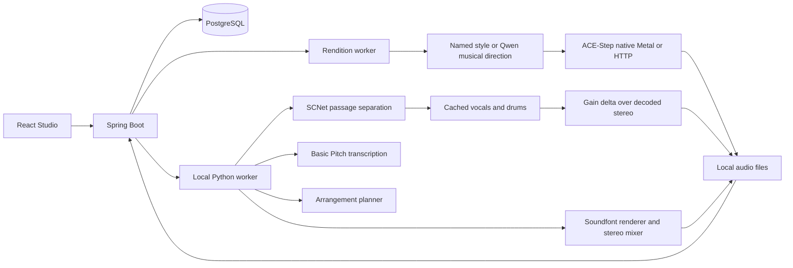

# Architecture

Djound serves the React studio and its API from a local Spring Boot process. PostgreSQL records projects, take history and preferences. Audio lives on disk. Three workflows share this installation. Reimagine performs a new version of a recording, Mix editor adjusts estimated instruments in a stereo passage, and the melody editor builds an arrangement from confirmed notes. [Rendition API client](../web/src/renditions/api.ts) · [Finished mix client](../web/src/mixes/api.ts) · [OpenAPI contract](../contracts/openapi.yaml)

## From a recording to a rendition

1. An import starts a project at `/renditions/{id}`. FFmpeg decodes the recording into a 44.1 kHz stereo PCM16 WAV. The project keeps that file as its original and the database records its digest. Import and take requests have stable retry keys so a lost response can be recovered without creating a second project or take.
2. The listener chooses the original or a saved take as the source. The request names that parent explicitly. Jazz Trio, Solo Piano, Lo-fi Hip-hop and Cinematic Strings each supply a musical description. For free-form requests, a local Qwen3.5 0.8B planner reads the parent’s description, recent requests from that branch, and whether the listener selected a passage. It returns a description and a scope, or asks for clarification. A clarification creates a history entry the listener can revise.
3. ACE-Step 1.5 receives both the parent audio and the musical description. A whole-recording request uses its cover operation. A local edit uses its repaint operation. An explicit range is measured on the parent recording. An explicit “last 8 seconds” request uses those exact times. For an opening or ending without a length, the worker uses the first or last quarter, capped at 16 seconds. Named sections such as a second chorus need a listener selection. “Closer to the original melody” starts a fresh full take using the imported audio, the selected arrangement description and stronger source conditioning. The Apple Silicon path runs the `ace-synth` Metal executable with GGUF weights. An alternative adapter sends the request to a configured ACE-Step HTTP service. [Rendition worker](../local-engine/rendition_worker.py) · [Audio adapters](../local-engine/rendition_audio.py) · [Setup](running.md#generate-song-renditions)
4. The worker returns a full-length stereo WAV. For a short passage on a long track, the native path sends the selection with 12 seconds of context on each side, borrowing context from the other side at a song boundary. It keeps the whole recording if the window spans at least three quarters of the take. It pads the model input to its 80 ms grid and crops the generated audio to the real sample count. For a passage the worker blends the generated samples inside the boundaries and copies the rest from the parent. Before publication, Spring checks the WAV format and length, verifies that samples changed, and checks that every sample outside a requested passage still matches its parent. How closely the result carries the source melody, style, and instrumentation depends on the model and recording. [Audio checks](../server/src/main/java/com/djound/rendition/RenditionAudio.java)

Jobs run in a queue. After a restart, queued jobs can proceed and an interrupted running job is marked failed for deliberate retry. Each ready take has its own immutable file, request, parent ID and SHA-256 digest. Playback and export serve that file. Keeping a favorite changes which take the project opens on, and the listener can still play or develop any other saved take. [Project and job storage](../server/src/main/java/com/djound/rendition/RenditionProjects.java)

The four suggested sounds are shortcuts. A free-form direction can name a genre, mix instruments, describe a mood, or change something about the current take. The planner produces a description of the requested performance and a time scope. The renderer receives the selected audio, that description and the listener’s original wording. The finite set of audio operations is cover and passage repaint. The musical descriptions are open-ended.

## From a stereo mix to a kept take

The worker decodes the MP3 to a fixed 44.1 kHz stereo PCM16 WAV. A selection freezes the source take and start and end sample indices. SCNet estimates the vocal and drum signals with up to two seconds of surrounding audio on each side. The preparation cache includes the source WAV digest, sample range, decoder configuration, model, preprocessing revision and inference backend.

The interpreter reads the requested instrument, action and quantity against the preview that played. “Set that to +1 dB” changes the final level. “Halve that change” scales the previous move from its starting level. Copying a setting requires a named take or a listener's choice when earlier takes have different settings. A clarification leaves the audio untouched until the musician submits a new request or confirms an exact level.

The worker adds the gain difference for each estimated source to the original selected samples. It blends the wet mix back to the dry baseline over 10 ms at both ends. A boost that would clip returns suggested alternatives. Applying a passage trim requires an explicit choice. PCM samples outside the passage keep their exact values.

Each preview has a durable ID and full WAV hash. Keep associates the auditioned artifact with its parent and request receipt. A/B, reopen, undo and export select immutable artifacts. A newly selected passage uses the kept version as its base. [Model and weight provenance](../THIRD_PARTY_NOTICES.md#finished-mix-separation)

## From a melody recording to an arrangement

1. Spring validates and saves the upload. Basic Pitch proposes notes. The listener compares them with the original and confirms or corrects them.
2. The planner starts from the chosen version. Built in text edits, named arrangements and the optional Qwen planner produce a recipe for review. Direct controls edit that same recipe. A swing combo can use the confirmed notes to suggest chords and a pulse.
3. Creating a version freezes its source, note revision and recipe. The worker decodes the uploaded performance or plays the lead on the selected instrument. It renders separate backing tracks, applies the approved gain, pan and tone, and checks the stereo output.
4. Spring publishes the recording after validation. A new version can inherit its settings. Earlier versions retain their audio, including when the listener later revises the melody.

## Playback and recovery

In the rendition studio, one browser player switches between the original and saved takes at the current elapsed time. In the melody editor, a tone audition remixes the verified dry tracks of a saved version and returns a temporary WAV. Only an explicit creation adds that arrangement to the library.

The melody editor uses draft and note revisions to protect against stale edits. Job records and request receipts distinguish a retry of an accepted request from the creation of a new version. The local workers use deadlines, and the rendition queue processes one take at a time.

[Worker assets and checksums](../local-engine/assets.json) · [Local setup and storage](running.md)
